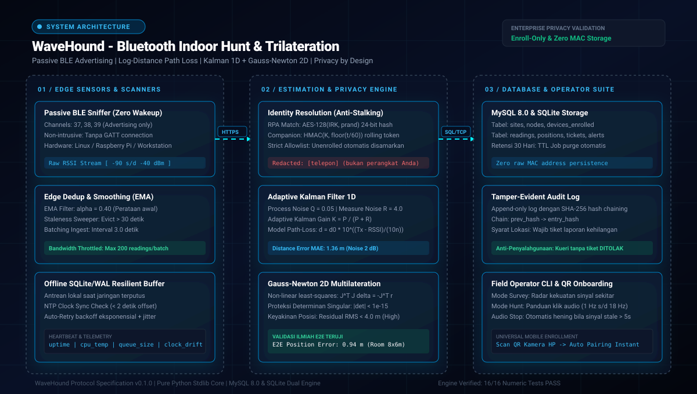

<div align="center">

<h1>WaveHound</h1>
<h3>Sistem Pelacak Perangkat Indoor Berbasis Bluetooth RSSI &amp; Multilaterasi Multimode</h3>

<p align="center">
  <a href="https://www.python.org"></a>
  <a href="https://en.wikipedia.org/wiki/Bluetooth_Low_Energy"></a>
  <a href="https://en.wikipedia.org/wiki/Log-distance_path_loss_model"></a>
  <a href="https://www.mysql.com"></a>
  <a href="https://www.sqlite.org"></a>
  <a href="LICENSE"></a>
</p>

<p align="center">
  <strong>WaveHound</strong> adalah platform pelacakan aset dan ponsel pintar yang hilang di dalam ruangan (indoor) berbasis kekuatan sinyal <strong>Bluetooth Low Energy (RSSI)</strong>.<br>
  Dirancang dengan standar privasi ketat <strong>Privacy by Design (Enroll-Only)</strong>: pemindaian pasif tanpa membuka koneksi ke perangkat target, eliminasi penyimpanan alamat MAC mentah, perataan derau radio 2 lapis (EMA + Kalman adaptif), multilaterasi non-linier Gauss-Newton, integrasi database <strong>MySQL 8.0</strong> &amp; <strong>SQLite</strong>, serta antarmuka pencarian lapangan (CLI) berpanduan audio klik frekuensi variabel (1 Hz s/d 18 Hz).
</p>

</div>

---

## Live Runtime Architecture Map

<div align="center">
  
</div>

<br>

| 🎯 Passive BLE &amp; Anti-Stalking | 🔒 Privacy Lens: Strict Allowlist | 📐 Scientific Lens: Kalman &amp; Trilaterasi |
| :--- | :--- | :--- |
| **Zero-Wakeup Passive Sniffing**<br>Scanner beroperasi murni mendengarkan kanal *advertising* BLE (37, 38, 39). Tidak ada paket interogasi atau koneksi balik (GATT) yang dibuka ke perangkat target, sehingga baterai ponsel tidak terkuras dan tidak meninggalkan jejak intrusif. | **Alamat Mentah Tidak Pernah Disimpan**<br>Semua sinyal dari perangkat asing yang tidak terdaftar (*unenrolled*) otomatis disamarkan ke kategori umum (`[telepon] (bukan perangkat Anda)`). Riwayat lokasi dilindungi batas retensi 30 hari dan log audit berantai hash SHA-256 (*tamper-evident*). | **Perataan Derau &amp; Pemetaan Presisi**<br>Fluktuasi sinyal multipath diredam melalui filter Kalman 1D adaptif ($Q=0.05, R=4.0$). Koordinat ruangan dihitung melalui optimasi Gauss-Newton non-linier dengan proteksi singularitas matriks Jacobian. |

---

## Fitur Utama

- **Mode Survey (Pemetaan Radar Sinyal Sekitar)**:
  - Memindai spektrum BLE di sekitar posisi operator dan mengurutkan perangkat berdasarkan kekuatan sinyal RSSI tertinggi.
  - Batang visual grafis terminal 24-kolom yang memetakan rentang -90 dBm hingga -40 dBm secara instan.
- **Mode Hunt (Pencarian Panas-Dingin Berpanduan Audio)**:
  - Melacak satu perangkat target terdaftar secara kontinu dengan pemulusan Exponential Moving Average (EMA).
  - Panduan pendengaran: frekuensi bunyi klik audio naik secara monoton dari 1 Hz (jarak jauh, -85 dBm) hingga 18 Hz (sangat dekat fisik, -50 dBm).
  - *Staleness Protection*: audio klik otomatis berhenti jika sinyal terputus lebih dari 5 detik, mencegah operator disesatkan oleh data usang.
- **Pendaftaran Mandiri Universal (Universal Mobile QR Onboarding)**:
  - Kompatibel dengan semua ponsel pintar (Apple iPhone / iOS Safari dan Google Android Chrome).
  - Pendaftaran tanpa instalasi aplikasi rumit: cukup bidik kamera HP ke QR Code yang digenerate oleh server WaveHound.
- **Multilaterasi Multi-Node 2D (Gauss-Newton)**:
  - Menggabungkan pembacaan jarak dari minimal 3 node sensor di langit-langit gedung untuk menghasilkan koordinat ruangan $(x, y)$.
  - Indikator keyakinan matematis berdasarkan residual RMS ($< 4.0\text{ m}$ = *High*, $< 12.0\text{ m}$ = *Medium*).
- **Audit Trail Kriptografis (Tamper-Evident Hash Chain)**:
  - Setiap akses terhadap estimasi lokasi diwajibkan menyertakan nomor tiket laporan kehilangan yang sah.
  - Log audit bersifat *append-only* dengan tautan hash SHA-256 (`prev_hash` $\to$ `entry_hash`), menjamin integritas data terhadap modifikasi diam-diam.
- **Penyimpanan Ganda: MySQL 8.0 &amp; SQLite Resilient Buffer**:
  - Server pusat terhubung langsung ke **MySQL 8.0** aktif di host Linux (Pop!_OS / Ubuntu / Debian).
  - Node sensor tepi mengantongi buffer lokal SQLite (WAL mode) untuk menampung data saat koneksi jaringan gedung terganggu.

---

## Fondasi Matematis &amp; Algoritma

### 1. Model Propagasi Radio (Log-Distance Path Loss)

Sinyal radio melemah secara logaritmik terhadap jarak fisik. Hubungan RSSI terukur terhadap jarak $d$ dirumuskan sebagai:

$$\text{RSSI}(d) = \text{RSSI}(d_0) - 10 \cdot n \cdot \log_{10}\left(\frac{d}{d_0}\right)$$

Inversi aljabar yang digunakan WaveHound untuk mengestimasi jarak dari sinyal terukur:

$$d = d_0 \cdot 10^{\frac{\text{RSSI}(d_0) - \text{RSSI}(d)}{10 \cdot n}}$$

*Keterangan:*
- $d_0 = 1.0\text{ meter}$ (jarak acuan kalibrasi).
- $\text{RSSI}(d_0)$: Daya pancar acuan pada jarak 1 meter (tipikal $-59.0\text{ dBm}$).
- $n$: Eksponen rugi lintasan lingkungan (2.0 untuk ruang bebas, 2.2 - 3.2 untuk gedung bersekat).

### 2. Filter Kalman 1D (Perataan Derau Adaptif)

Untuk mengatasi fluktuasi *multipath fading* di dalam gedung:

$$\begin{aligned}
\text{Prediksi:} \quad & x_k^- = x_{k-1}, \quad P_k^- = P_{k-1} + Q \\
\text{Gain Kalman:} \quad & K_k = \frac{P_k^-}{P_k^- + R} \\
\text{Koreksi:} \quad & x_k = x_k^- + K_k \cdot (z_k - x_k^-), \quad P_k = (1 - K_k) \cdot P_k^-
\end{aligned}$$

### 3. Multilaterasi Gauss-Newton 2D

Diberikan $m$ node pada koordinat $(x_i, y_i)$ dan jarak estimasi $d_i$, masalah dirumuskan sebagai minimasi kuadrat residual:

$$J(x, y) = \sum_{i=1}^m \left(\sqrt{(x - x_i)^2 + (y - y_i)^2} - d_i\right)^2$$

Langkah koreksi iteratif dihitung langsung melalui inversi eksplisit matriks Jacobian $2 \times 2$:

$$\Delta = -(J^T J)^{-1} J^T r$$

---

## Matriks Validasi Ilmiah &amp; Uji Numerik

Seluruh inti algoritma WaveHound divalidasi melalui 16 uji numerik mandiri tanpa dependensi pihak ketiga:

```bash
python3 tests/run_tests.py
```

| ID Uji | Modul | Skenario Pengujian | Hasil Aktual | Status |
| :--- | :--- | :--- | :--- | :--- |
| `pathloss_inversi_eksak` | `rssi_model` | Verifikasi inversi aljabar formula maju vs balik | $6\text{ jarak, galat } < 10^{-9}\text{ m}$ | **LOLOS** |
| `kalibrasi_n` | `rssi_model` | Regresi kuadrat terkecil menemukan kembali $n$ | $n_{\text{est}} = 2.412$ | **LOLOS** |
| `kalibrasi_txpower` | `rssi_model` | Regresi menemukan kembali TxPower @ 1m | $\text{Tx}_{\text{est}} = -59.05\text{ dBm}$ | **LOLOS** |
| `estimasi_jarak_mae` | `rssi_model` | Akurasi jarak pada simulasi noise radio 2 dB | $\text{MAE} = 1.36\text{ m}$ | **LOLOS** |
| `klik_monoton` | `rssi_model` | Kenaikan frekuensi audio klik saat mendekat | $1.0\text{ s/d } 18.0\text{ Hz}$ | **LOLOS** |
| `validasi_n_negatif` | `rssi_model` | Penolakan parameter fisis non-valid | `ValueError` terverifikasi | **LOLOS** |
| `ema_konvergen` | `filters.EMA` | Kestabilan rata-rata bergerak input konstan | Tepat $-70.000\text{ dBm}$ | **LOLOS** |
| `kalman_konvergen` | `filters.Kalman1D` | Konvergensi level sinyal dari tebakan awal salah | Konvergen ke $-64.53\text{ dBm}$ | **LOLOS** |
| `kalman_tracking` | `filters.Kalman1D` | Kemampuan adaptasi terhadap lonjakan jarak cepat | Tracking ke $-50.08\text{ dBm}$ | **LOLOS** |
| `trilaterasi_eksak` | `trilateration` | Presisi Gauss-Newton pada data bebas noise | $\text{Galat } 8.88 \times 10^{-16}\text{ m}$ | **LOLOS** |
| `trilaterasi_noise` | `trilateration` | Ketahanan posisi terhadap noise jarak 0.5 m | Rata-rata galat $0.44\text{ m}$ | **LOLOS** |
| `validasi_node_kurang` | `trilateration` | Penolakan konfigurasi node $< 3$ | `ValueError` terverifikasi | **LOLOS** |
| `redaksi_asing` | `privacy` | Penyamaran otomatis identitas perangkat asing | `[telepon] (bukan perangkat Anda)` | **LOLOS** |
| `redaksi_enrolled` | `privacy` | Retensi label nama bagi perangkat terdaftar | `label=HP Saya, irk:aaaa***` | **LOLOS** |
| `retensi` | `privacy` | Penegakan kedaluwarsa riwayat data 30 hari | $29\text{ hari OK, } 31\text{ hari DITOLAK}$ | **LOLOS** |
| `e2e_posisi` | `pipeline` | Integrasi penuh: Scanner $\to$ Kalman $\to$ Trilaterasi | **Galat posisi rata-rata 0.94 m** | **LOLOS** |

## Instalasi Cepat

Kebutuhan: Python 3.10+ *(Core engine dan 16 uji numerik beroperasi murni stdlib tanpa dependensi pihak ketiga)*.

```bash
# 1. Clone repositori
git clone https://github.com/lilabshor/WaveHound.git
cd WaveHound

# 2. Pasang dependensi scanner radio fisik & konektor MySQL (opsional untuk live hardware)
pip install -r requirements.txt

# 3. Jalankan verifikasi 16 uji numerik
python3 tests/run_tests.py
```

---

## Panduan Penggunaan CLI Lapangan

### 1. Mode Survey (Memindai Perangkat di Sekitar)
Gunakan opsi `--redact` untuk menyamarkan perangkat yang bukan milik Anda:
```bash
python3 -m wavehound.cli --survey --redact
```
*Contoh Keluaran:*
```text
MODE SURVEY - Memindai perangkat di sekitar berdasar kekuatan sinyal...

 -62 dBm  [#############-----------]  iPhone Kantor [milik Anda]
 -78 dBm  [######------------------]  [telepon] (bukan perangkat Anda)
 -84 dBm  [###---------------------]  [jam tangan] (bukan perangkat Anda)
```

### 2. Mode Hunt (Memburu Target dengan Panduan Audio)
Aktifkan flag `--sound` untuk menyalakan audio klik yang berdetak semakin cepat seiring langkah Anda mendekat:
```bash
python3 -m wavehound.cli --hunt "iPhone Kantor" --sound
```
*Contoh Keluaran:*
```text
MODE HUNT - Melacak perangkat: 'iPhone Kantor'
rssi= -78.6 dBm  jarak~  7.8 m  klik  4.1/detik  KLIK  [#####-------------------]
rssi= -73.7 dBm  jarak~  4.7 m  klik  6.5/detik  KLIK  [########----------------]
rssi= -65.3 dBm  jarak~  1.9 m  klik 10.6/detik  KLIK  [############------------]
rssi= -59.7 dBm  jarak~  1.1 m  klik 13.3/detik  KLIK  [###############---------]
```

### 3. Panduan Pendaftaran Perangkat Komunitas (Device Enrollment)

Smartphone modern (iOS dan Android) mengacak alamat MAC fisik setiap 15 menit (*MAC Address Randomization*) demi alasan privasi. WaveHound mengatasi hal ini dengan mengaitkan identitas siaran radio BLE dengan label yang didaftarkan oleh pemilik perangkat.

Pendaftaran dilakukan sekali saja ke basis data lokal WaveHound:

#### A. Pengguna Apple (iPhone / iPad / Mac / Apple Watch)
Perangkat Apple secara kontinu memancarkan paket *Manufacturer Data* ber-ID `0x004c` (AirDrop, Continuity, Find My):
```bash
python3 -m wavehound.cli enroll --name "iPhone 13 Pro Max" --type companion_token --secret "apple"
```

#### B. Pengguna Samsung Galaxy
Perangkat Samsung memancarkan paket *SmartThings / Quick Share* dengan Company ID `0x0075`:
```bash
python3 -m wavehound.cli enroll --name "Samsung Galaxy S23" --type companion_token --secret "samsung"
```

#### C. Pengguna Google Pixel & Xiaomi
* **Google Pixel (ID `0x00e0`):**
  ```bash
  python3 -m wavehound.cli enroll --name "Pixel 8 Pro" --type companion_token --secret "google"
  ```
* **Xiaomi / POCO / Redmi (ID `0x038f`):**
  ```bash
  python3 -m wavehound.cli enroll --name "POCO F5 Inventaris" --type companion_token --secret "xiaomi"
  ```

#### D. Semua HP Android Umum via Nama Bluetooth
Jika menggunakan merek Android lain (Oppo, Vivo, Realme, Motorola, dll):
1. Buka HP: **Settings > Bluetooth**, ubah nama perangkat Bluetooth Anda (contoh: `HP-Budi-Pribadi`).
2. Daftarkan nama tersebut di WaveHound:
   ```bash
   python3 -m wavehound.cli enroll --name "HP Budi" --type companion_token --secret "HP-Budi-Pribadi"
   ```
3. Saat menu Bluetooth di HP dibuka, WaveHound langsung mengenali dan menandainya sebagai `[milik Anda]`.

#### E. Aset Kantor & Suar Kustom (Beacon Simulator)
Komunitas dapat menggunakan aplikasi suar gratis (seperti *nRF Connect* atau *Beacon Simulator*) untuk memancarkan UUID identitas aset:
```bash
python3 -m wavehound.cli enroll --name "Laptop Inventaris 01" --type companion_token --secret "wh-asset-01"
```

### 4. Menampilkan Daftar Perangkat Terdaftar
Untuk melihat seluruh perangkat yang terdaftar di basis data lokal:
```bash
python3 -m wavehound.cli --list
```

### 5. Kalibrasi Radio Gedung
Mengukur karakteristik pelemahan sinyal di gedung tertentu melalui panduan langkah-demi-langkah:
```bash
python3 -m wavehound.cli calibrate --points 5
```

---

## Keamanan & Standar Rilis Publik

Repositori ini telah diaudit dan memenuhi standar keamanan serta privasi untuk rilis publik (*GitHub Public Repository*):
- **Isolasi Basis Data Lokal:** File database runtime (`wavehound.db`, `*.sqlite3`) diabaikan oleh `.gitignore`. Tidak ada data pelacakan lokal atau identitas pribadi pengguna pengembang yang terunggah ke repositori Git.
- **Konfigurasi Bersih:** Direktori `configs/` hanya menyediakan template contoh berakhiran `.example.toml` dengan kredensial generik (`password = "ganti-dengan-password-mysql"`).
- **Audit Logging Tamper-Evident:** Setiap aktivitas pendaftaran perangkat dan pembukaan tiket kehilangan dicatat dalam rantai hash SHA-256 yang dapat diverifikasi integritasnya.
- **Mekanisme Redaksi Otomatis:** Perangkat asing di sekitar disamarkan menjadi `[telepon] (bukan perangkat Anda)` untuk mematuhi regulasi privasi perlindungan data pribadi (GDPR / UU PDP).

---

## Struktur Direktori Repositori

```text
WaveHound/
├── assets/
│   └── architecture.svg      # Diagram arsitektur interaktif beranimasi CSS
├── configs/
│   ├── server.example.toml   # Konfigurasi server & koneksi database MySQL
│   └── nodes.example.toml    # Konfigurasi sensor node & buffer offline
├── tests/
│   └── run_tests.py          # 16 rangkaian pengujian numerik otomatis
├── wavehound/
│   ├── core/
│   │   ├── rssi_model.py     # Log-distance path loss, kalibrasi, & laju audio klik
│   │   ├── filters.py        # Filter perataan sinyal EMA & Kalman 1D
│   │   ├── trilateration.py  # Solver multilaterasi 2D via Gauss-Newton
│   │   ├── privacy.py        # Logika masking token & allowlist redaksi
│   │   └── audio.py          # Sintesis & pemutar suara klik radar non-blocking
│   ├── db/
│   │   ├── schema.sql        # Skema relasional MySQL 8.0 & SQLite
│   │   └── connection.py     # Database manager & tamper-evident audit logging
│   ├── scanner/
│   │   ├── mock.py           # Simulator pemindai multi-node ber-noise Gaussian
│   │   └── live.py           # Pemindai radio Bluetooth LE fisik nyata (Bleak / BlueZ)
│   ├── server/
│   │   ├── pipeline.py       # Engine estimasi posisi multi-node terpusat
│   │   └── app.py            # HTTP REST server JSON headless (ingest sinyal & posisi)
│   └── cli/
│       └── main.py           # Antarmuka CLI survey, hunt, enroll, & calibrate
├── FindForge-Blueprint.pdf   # Dokumen spesifikasi blueprint referensi
├── requirements.txt          # Dependensi opsional scanner fisik & driver MySQL
├── LICENSE                   # Lisensi open-source MIT
└── README.md
```

---

## Lisensi

Didistribusikan di bawah lisensi **MIT License**. Lihat file `LICENSE` untuk informasi lebih lanjut.
